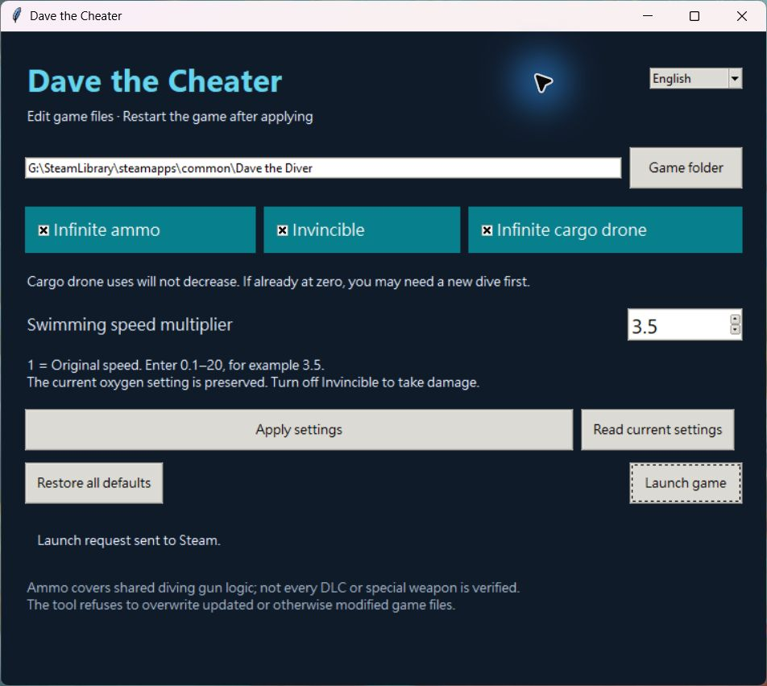

# Dave the Cheater

A Windows GUI for a supported Steam installation of **DAVE THE DIVER**, using Python, Tkinter and the standard library. No downloaded trainers or runtime injection.

## GUI preview



The top-right language selector switches between **English** and **繁體中文**.

## Features

- Swimming speed multiplier, 0.1x to 20x.
- Infinite ammo, invincibility and infinite cargo-drone switches.
- Traditional Chinese / English UI with remembered language preference.
- Steam launch button, highlighted success status, original-file restore, running-game checks, version validation and failed-write rollback.
- Preserve the current oxygen patch when applying other controls.

**Close the game before applying settings and restart afterward.** Switches do not modify files until Apply settings is clicked.

## Setup

Requires Windows, Python 3.10+ with Tkinter, Steam, and your own game installation. No pip packages are needed.

This tool supports one specific build. The observed title screen reported `v1.0.6.2132.steam`; exact SHA-256 checks determine compatibility. Updated or otherwise modified files are rejected.

Game binaries, modified game files, backups, preferences and reports are not distributed in this repository. For a fresh checkout, prepare ignored local backups from your own unmodified supported installation:

```powershell
python prepare_backups.py --game 'D:/SteamLibrary/steamapps/common/Dave the Diver'
```

Preparation validates both originals before creating backups. It does not modify game files. Existing verified backups are retained. Unsupported or already-modified originals are rejected.

Then double-click `Start-Dave-Controls.cmd`, or run:

```powershell
python control_panel.py
```

## How to use

1. **Close DAVE THE DIVER completely.** Steam can remain open.
2. Open **Start-Dave-Controls.cmd**, or run `python control_panel.py`.
3. Click **Game folder** and select the folder containing `DaveTheDiver.exe`.
4. Choose **English** or **繁體中文** from the top-right language selector.
5. Enable or disable **Infinite ammo**, **Invincible**, and **Infinite cargo drone**. A checked, teal button means enabled.
6. Enter a **Swimming speed multiplier**, such as `3.5`. `1` restores normal swimming speed; the allowed range is `0.1`–`20`.
7. Click **Apply settings**. Wait for the green, bold success message confirming the files were written and checked.
8. Click **Launch game** to start through Steam, then test the changes in-game.

Editing a field or switch does not apply it automatically. If you launch with unapplied changes, the GUI asks whether to use the previously applied settings. A running game blocks file changes.

**Read current settings** reloads the actual file settings. **Restore all defaults** restores the original game files, disables the feature patches (including oxygen), and returns speed to `1`. Normal Apply settings preserves the existing oxygen-patch state.

If ammo or drone uses are already zero, you may need to refill or start a new dive first. See [繁體中文操作說明](GUI-使用說明.md) for the Chinese guide.

## Scope and verification

Swimming speed does not adjust sushi-restaurant walking speed. Ammo targets shared diving-gun logic and its inlined decrement; coverage is not verified for every DLC, special weapon or minigame. Empty guns may need one refill.

The cargo-drone option stops four identified use-count decrements in net/cargo interactions. It does not unlock the drone or refill empty counts; a new dive may be needed. Invincibility targets damage immunity and hit damage; scripted deaths remain unverified.

The user reported that the oxygen patch works. Other effects have not been comprehensively measured. File-level and GUI tests do not establish complete in-game coverage.

## Tests

```powershell
python -m unittest discover -v
```

Source checks need no game files. File-integration tests skip unless original backups are present. Integration tests use temporary fixtures instead of the real installation; they cover patch combinations, multiplier bounds, version mismatch, game-running guards, restore and rollback.

## Files

For parameter discovery, adding features, and remapping after game updates, read [AGENTS.md](AGENTS.md).

- `control_panel.py`: GUI and guarded file updates.
- `gui_language.py`: translations.
- `inspect_dave.py`: UnityFS/LZ4/Addressables/serialized-asset inspection and rebuilding.
- `prepare_backups.py`: validate and prepare local original backups.
- `test_source.py`, `test_control_panel.py`: source and file-integration tests.

Unofficial tool, not affiliated with the game's developer or publisher. No game assets or full game binaries are included.
