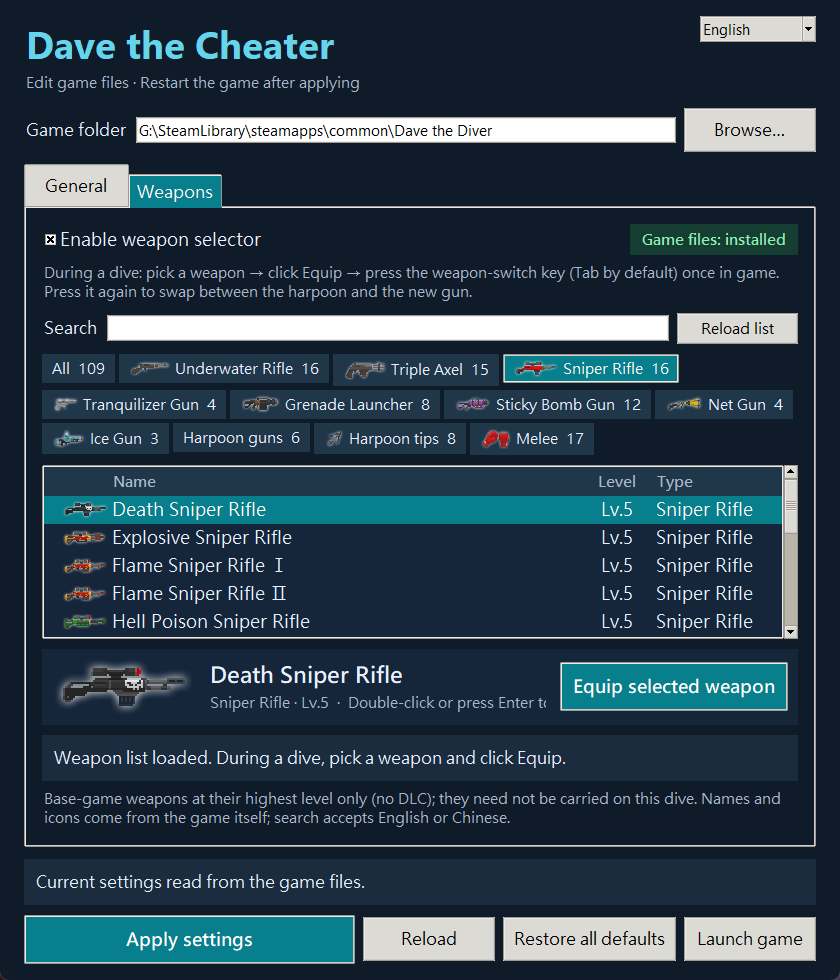

# Dave the Cheater

A Windows GUI for a supported Steam installation of **DAVE THE DIVER**, using Python, Tkinter and the standard library. No downloaded trainers or runtime injection.

## GUI preview




The top-right language selector switches between **English** and **繁體中文**.

## Features

- Live multipliers, adjustable while the game runs (no relaunch):
  - Swimming speed, 0.1x to 20x.
  - Backpack capacity, 0.1x to 20x or unlimited (1000x): the dive backpack's weight limit and overload threshold.
  - Sushi bar movement speed, 0.1x to 10x (Dave's walking, running and tired speed while serving).
- Infinite oxygen, infinite ammo, invincibility and infinite cargo-drone switches.
- Underwater weapon selector: equip any base-game weapon mid-dive from a searchable list, grouped into tabs by weapon type (Underwater Rifle, Sniper Rifle, Tranquilizer Gun, Grenade Launcher, harpoon tips, melee and more), with the game's official English or Traditional Chinese names and in-game icons.
- Traditional Chinese / English UI with remembered language preference.
- Steam launch button, colour-coded status bar, original-file restore, running-game checks, version validation and failed-write rollback.
- Keyboard shortcuts: **Ctrl+S** applies settings, **F5** reloads them from the game files.

**Close the game before applying settings and restart afterward.** Switches do not modify files until Apply settings is clicked. The multipliers only need **Enable live multipliers** applied once; after that they change in the running game.

## Setup

Requires Windows (or a Steam Deck / Linux PC, see [Steam Deck](#steam-deck)), Python 3.10+ with Tkinter, Steam, and your own game installation. No pip packages are needed.

This tool supports one specific build. The observed title screen reported `v1.0.6.2132.steam`; exact SHA-256 checks determine compatibility. Updated or otherwise modified files are rejected.

Game binaries, modified game files, backups, preferences and reports are not distributed in this repository. For a fresh checkout, prepare ignored local backups from your own unmodified supported installation:

```powershell
python prepare_backups.py --game 'D:/SteamLibrary/steamapps/common/Dave the Diver'
```

Preparation validates both originals before creating backups. It does not modify game files. Existing verified backups are retained. Unsupported or already-modified originals are rejected.

Then double-click `Start-Dave-Controls.cmd`, or run:

```powershell
python control_panel.py
```

## How to use

1. **Close DAVE THE DIVER completely.** Steam can remain open.
2. Open **Start-Dave-Controls.cmd**, or run `python control_panel.py`.
3. Check the **Game folder** path; click **Browse…** to select the folder containing `DaveTheDiver.exe` if it differs.
4. Choose **English** or **繁體中文** from the top-right language selector.
5. Enable or disable **Infinite oxygen**, **Infinite ammo**, **Invincible** and **Infinite cargo drone**. A checked, teal button means enabled.
6. Tick **Enable live multipliers** (needed once).
7. Click **Apply settings**. It turns amber while there are unapplied changes. Wait for the green success message confirming the files were written and checked.
8. Click **Launch game** to start through Steam.
9. While playing, change **Swimming speed**, **Backpack capacity** (or tick **Unlimited**) and **Sushi bar speed** by typing a value or clicking a preset. The badge shows **Active in game** once the panel has written them. Keep the panel open: every launch starts at 1×, and the panel reapplies your values automatically.

Editing a field or switch does not apply it automatically. If you launch with unapplied changes, the GUI asks whether to use the previously applied settings. A running game blocks file changes.

The status bar above the buttons is shared by both tabs: green means success, amber means unapplied changes or a waiting step, red means an error. **Reload** rereads the actual file settings. **Restore all defaults** restores the original game files, disables every patch including oxygen and the weapon selector, and removes the live multipliers.

If ammo or drone uses are already zero, you may need to refill or start a new dive first. See [繁體中文操作說明](GUI-使用說明.md) for the Chinese guide.

## Steam Deck

The panel also runs on the Steam Deck in **desktop mode** (and other Linux PCs). The game runs under Proton as the same Windows build, so the supported-build checks, backups and file patches are identical; only process detection, live writes and paths use Linux mechanisms. Steam Deck support is tested with a simulated `/proc`, **not yet on a real Deck**.

1. Switch to desktop mode, copy the whole `dave-inspector` folder to the Deck (e.g. `~/dave-inspector`), and keep the same file layout.
2. Prepare backups from your own unmodified installation, then start the panel. In Konsole:

   ```sh
   cd ~/dave-inspector
   python3 prepare_backups.py
   sh Start-Dave-Controls.sh
   ```

   The game folder is found automatically from Steam's library list, including SD-card libraries; otherwise use **Browse…**.
3. Use the panel as on Windows: close the game, tick **Enable live multipliers** (and any switches), click **Apply settings**, then **Launch game**. Keep the panel open while you play; switch between it and the game with the Steam button or Alt+Tab.

Differences on the Deck:

- **Live multipliers and the weapon selector** write to the game through `/proc/<pid>/mem`, after the same exact-code checks as on Windows (the loaded `GameAssembly.dll` is identified by its mapped path or, inside Steam's container, by its PE header). SteamOS may block access to another program's memory. If the badge reports this, run `sudo sysctl kernel.yama.ptrace_scope=0` in Konsole (it needs a password set with `passwd`, and resets at reboot), then change a value again. File patches do not need this.
- **Tkinter:** the panel needs Python 3 with Tkinter. `Start-Dave-Controls.sh` checks for it and says so if it is missing; whether the stock SteamOS Python includes it has not been verified.
- **Weapon equip confirmation** reads `Player.log` from the game's Proton prefix (`steamapps/compatdata/1868140/pfx/...`).
- On the Deck's 1280×800 screen both tabs scroll; use the scrollbar, the touchpad or the touchscreen on the scrollbar.

## Scope and verification

### Weapons tab

Equipping a weapon mid-dive and swapping to it has been **tested in game** on the supported build. The list comes from your own local data: base-game guns, harpoons, harpoon heads and melee weapons, one entry per weapon at its highest level, including weapons not carried on the current dive; DLC weapons are not currently included. It loads automatically in the background when the panel opens. Weapon names are the game's own official names in the panel language (Traditional Chinese or English), read from your local text tables; search accepts either language. Each row also shows the weapon's in-game icon, and the bar above the status line shows the selected weapon's larger icon next to **Equip selected weapon**. Names and icons come from your own game files: the first load takes about ten seconds, after which they are cached in the ignored local file `weapon-names-cache.json` and folder `weapon-icons/`. Harpoon guns and the dive knife have no item icon in the game data, so they are listed without one.

1. With the game closed, open **Weapons**, tick **Enable weapon selector** and click **Apply settings**. The badge on the right shows whether the selector is installed in the game files.
2. Start the game and begin a dive.
3. Pick a category tab or use **Search**, then click **Equip selected weapon** (or double-click it, or press Enter). The tabs group guns by the game's own families (Underwater Rifle, Triple Axel, Sniper Rifle, Tranquilizer Gun / Hush Darts, Grenade Launcher, Sticky Bomb Gun, Net Gun, Ice Gun), followed by harpoon guns, harpoon tips and melee weapons, each with a count.
4. Return to the game and press your **weapon-switch key** (Tab by default) once to equip it, then again to swap between the harpoon and the new gun.

After queueing, the panel watches the game's `Player.log` for up to three minutes and turns the weapon status green once the game has loaded the weapon. Your last selected weapon is remembered.

Only the first key press after each queue equips; every other press is the game's normal harpoon/gun swap. Queueing writes only a four-byte weapon ID into unused read/write memory; the game's own input handler performs the equip on its thread. No game code is modified at runtime, and no remote thread or external mod loader is used. Disable the selector and apply while the game is closed to restore the original file.

### Live multipliers

After **Enable live multipliers** has been applied once with the game closed, each multiplier box takes effect while the game runs: the panel writes only a four-byte value per multiplier into unused read/write memory of the game process (after checking the exact game build and the installed patch), and the badge shows **Active in game**. The game itself always starts at 1×; while the panel is open it reapplies your remembered values after each launch. No DLL is injected and no remote thread is created. Disable the option and apply while the game is closed to restore the original file.

- **Swimming speed** scales Dave's base swimming speed, read every movement update, so it changes at once. Boosters and other speed effects still apply on top. Earlier versions stored swimming speed in a game data file; applying with live multipliers enabled moves your old value to the live control and restores that file.
- **Backpack capacity:** every backpack level has a **weight limit** (the "x / 42 kg" shown while diving; above it Dave slows down) and a higher **overload threshold** (above it he can no longer pick anything up). The pickup threshold changes at once. The game computes the displayed limit and slowdown point when a dive starts, so changes to those apply from your next dive. **Unlimited** multiplies both by 1000.
- **Sushi bar speed** scales the walk, run and tired multipliers Dave uses in the main sushi bar, the event variant and the Jungle DLC restaurant; it does not change hired staff, customers or village walking.

Swimming speed, backpack capacity and the live sushi bar speed are statically verified (disassembly of the patched copy) and file-tested, but not yet confirmed in game. Ammo targets shared diving-gun logic and its inlined decrement; coverage is not verified for every DLC, special weapon or minigame. Empty guns may need one refill.

The cargo-drone option stops four identified use-count decrements in net/cargo interactions. It does not unlock the drone or refill empty counts; a new dive may be needed. Invincibility targets damage immunity and hit damage; scripted deaths remain unverified.

The user reported that the oxygen patch works. Other effects have not been comprehensively measured. File-level and GUI tests do not establish complete in-game coverage.

## Tests

```powershell
python -m unittest discover -v
```

Source checks need no game files. File-integration tests skip unless original backups are present. Integration tests use temporary fixtures instead of the real installation; they cover patch combinations, multiplier bounds, version mismatch, game-running guards, restore and rollback.

## Files

For parameter discovery, adding features, and remapping after game updates, read [AGENTS.md](AGENTS.md).

- `control_panel.py`: GUI and guarded file updates.
- `gui_language.py`: translations.
- `inspect_dave.py`: UnityFS/LZ4/Addressables/serialized-asset inspection and rebuilding.
- `prepare_backups.py`: validate and prepare local original backups.
- `weapon_selector.py`: underwater weapon selector, local catalogue reader (official names, weapon categories) and the shared guarded live-memory write.
- `weapon_icons.py`: crops weapon icons from your local sprite atlas into the ignored `weapon-icons/` cache.
- `sushi_speed.py`: live sushi bar movement speed patch.
- `live_multipliers.py`: live swimming speed and backpack capacity hooks.
- `test_source.py`, `test_control_panel.py`: source and file-integration tests.
- `steam_platform.py`: Windows vs. Linux/Steam Deck plumbing (finding the game, `/proc` process detection and live writes, Proton `Player.log`, launching); `Start-Dave-Controls.sh` is the Linux launcher.
- `test_weapon_selector.py`, `test_weapon_icons.py`, `test_sushi_speed.py`, `test_live_multipliers.py`, `test_steam_platform.py`: feature tests with simulated game memory and fixtures.

Unofficial tool, not affiliated with the game's developer or publisher. No game assets or full game binaries are included.
